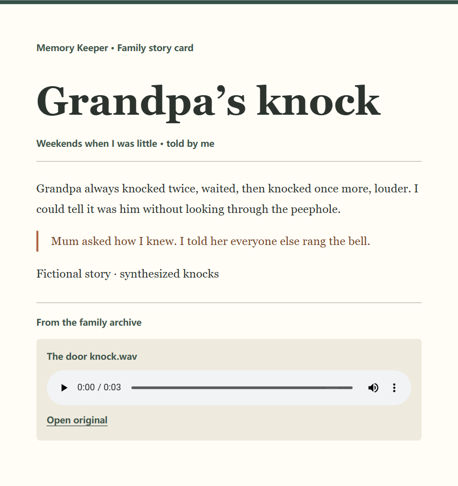

# Memory Keeper

[中文](README_CN.md) · [Hear the three-second knock](https://raw.githubusercontent.com/TingdeLiu/Tyndall-Skills/main/memory-keeper/examples/knock.wav) · [Download the example card](https://github.com/TingdeLiu/Tyndall-Skills/raw/refs/heads/main/memory-keeper/examples/knock-en.zip)

**What did your grandpa’s knock sound like?** Save the story in his words, keep the recording beside it, and make a card your family can listen to. Memory Keeper works in Codex and Claude Code. The stories live in a folder you choose.

[](https://github.com/TingdeLiu/Tyndall-Skills/raw/refs/heads/main/memory-keeper/examples/knock-en.zip)

**Try it before installing.** Download the example above, extract the ZIP, and open `index.html` in a browser. Press play to hear the two light knocks and the louder one. The story is fictional and the sound is synthesized. Your family opens a card the same way, even offline.

## Make your first card

If you use Codex, paste this into a chat:

```text
Install the memory-keeper skill from https://github.com/TingdeLiu/Tyndall-Skills/tree/main/memory-keeper
```

For Codex or Claude Code, you can also run the following in your project and choose your agent. The installer uses Node.js. Making cards, archiving media and exporting books use Python 3 and its standard library. [Installer requirements](https://github.com/vercel-labs/skills#install-a-skill)

```sh
npx skills add https://github.com/TingdeLiu/Tyndall-Skills/tree/main/memory-keeper
```

1. **Start with one sentence.** “Help me save a memory. Grandpa always knocked twice, waited, then knocked once more. I knew it was him.” The skill suggests a folder and shows you the draft.
2. **Add something you can hear or see.** Give the agent a local recording or photo and say “Keep this with the story.” For a recipe or a craft, you can also mark which step a photo or video shows.
3. **Make something for one person.** “Make a card for my sister with Grandpa’s story and that recording.” You get a ZIP in the vault’s `exports/` folder. You choose who gets a copy.

## Come back to it

- **Before a visit** — “Help me interview Mum about her first job. Give me one question to start with.”
- **After a visit** — “Pick up where we left off in her interview.” A saved transcript keeps its place, and each filed story points back to the lines it came from.
- **For a birthday** — “Make a printable book of Grandma’s stories.” The book opens in a browser and prints to paper or PDF.

Each story is a Markdown file you can open and edit. Back up the whole vault to keep stories and originals together. Conversations go through the AI service you use. A card includes the one story and the complete media files you select, including any recording beyond a marked time and any embedded photo metadata. Private stories require an explicit choice to share.

If you try it with family, what was the first thing you wanted to save? Suggestions and bug reports are welcome. Please use made-up examples in public issues. [Open an issue](https://github.com/TingdeLiu/Tyndall-Skills/issues)
