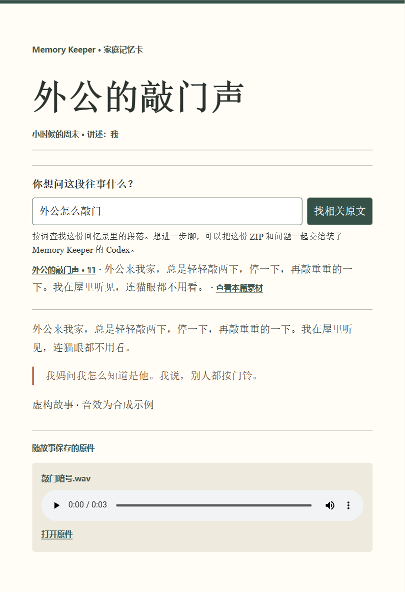

# 再讲一遍 · 可以提问的家庭回忆录

[English](README.md) · [听 3 秒敲门声](https://cdn.jsdelivr.net/gh/TingdeLiu/Tyndall-Skills@cdada5c/memory-keeper/examples/knock.wav) · [下载整张示例卡](https://github.com/TingdeLiu/Tyndall-Skills/raw/refs/heads/main/memory-keeper/examples/knock-zh.zip)

**「你当时怎么知道门外是外公？」** 家人可以从你留下的故事里找答案，再点开录音听那两轻一重。平时在 Codex 或 Claude Code 里讲一件小事就能开始。文字、照片和原声存在你选的文件夹里。安装名是 `memory-keeper`。

[](https://github.com/TingdeLiu/Tyndall-Skills/raw/refs/heads/main/memory-keeper/examples/knock-zh.zip)

**先问一张。** 下载示例，解压后打开 `index.html`，输入「外公怎么敲门」，点结果回到原文，再听那三声。浏览器断网也能按词找段落。故事是虚构的，敲门声为合成示例。

## 做自己的第一张卡

用 Codex 的话，可以直接在对话里发这句：

```text
请安装这个家庭记忆技能：https://github.com/TingdeLiu/Tyndall-Skills/tree/main/memory-keeper
```

Codex 和 Claude Code 也可以在项目目录运行下面的命令，再选择自己用的工具。安装器用 Node.js。做记忆卡、保存原件和导出成书用 Python 3 标准库。[安装器要求](https://github.com/vercel-labs/skills#install-a-skill)

```sh
npx skills add https://github.com/TingdeLiu/Tyndall-Skills/tree/main/memory-keeper
```

1. **先留一句话。**「帮我记一下，外公来我家，轻轻敲两下，等一等，再重重敲一下。我在屋里就知道是他。」第一次它会推荐一个文件夹，把整理好的文字给你过目。
2. **配上一件原件。** 给它一段本地录音或一张照片，说「把这个和刚才的故事放在一起」。记录一道家常菜或一门手艺时，还可以告诉它哪张照片、视频里的哪几秒对应哪一步。
3. **做给一个人。**「把这个故事和刚才那段录音做张卡，我想给姐姐听。」成品在记忆库的 `exports/` 文件夹里，你自己决定发给谁。

## 家人怎么跟它聊

姐姐可以直接把 ZIP 的本地路径给装了这个技能的 Codex，说「只根据这份回忆录回答。你怎么知道来的是外公？请给我看原文。」接着问「他为什么从来不按门铃？」故事只记下了敲门的习惯，Codex 应当告诉她，外公的原因没有留下记录。每段回答都可以按篇名、段落号回到原文，有录音的篇目也能打开原件。

你可以选多篇故事分享。收件人无需建立自己的记忆库。你自己使用时，第一次选定库，往后就能直接问「我跟你讲过外公哪些事？」。让它照你的措辞写信，得到的是 AI 代拟的草稿。想听真实声音，可以回放留下的录音；这个技能没有声音克隆或实时变声通话功能。

## 下次回家时，还能这样用

- **出发前**说「我想问问我妈第一次上班的事，帮我想个开头，一次问一个问题」。
- **回家后**说「接着整理上次那份采访」。保存过的转写会记住进度，每段整理好的故事都能找到原文行号。
- **过生日前**说「把外婆讲过的故事做成一本书」。浏览器打开就可以打印，也能另存成 PDF。

每篇故事都是能直接打开和编辑的 Markdown 文件。备份时复制整个记忆库，照片和声音就能跟着搬家。聊天内容会经过你使用的 AI 服务。记忆卡带上你点名的**完整原件**，包括时间标记之外的录音，以及照片里原有的拍摄信息。分享标为私密的故事需要明确确认。

打算下次回家再试，可以先在仓库右上角点 **Star**，到时候从收藏里找回来。如果试用时卡在哪一步，欢迎用虚构例子来提建议。[收藏仓库](https://github.com/TingdeLiu/Tyndall-Skills) · [反馈使用体验](https://github.com/TingdeLiu/Tyndall-Skills/issues)
