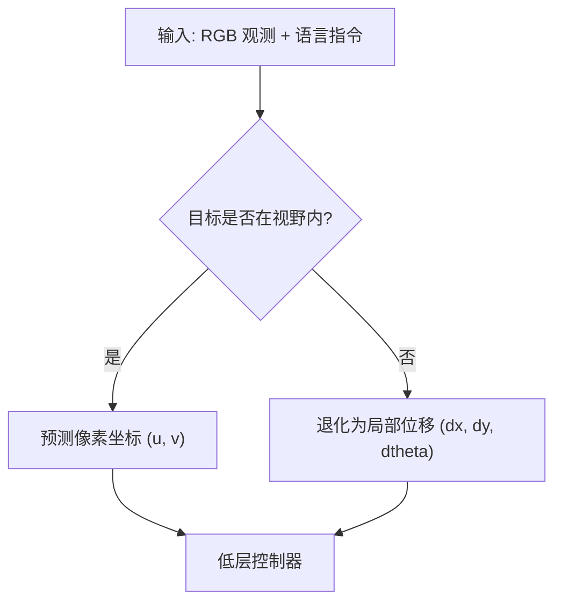

# Paper Summary Skill

结构化中文论文摘要生成（VLN / VLA / VLM / RL / Robotics）。工作流：先读 PDF 识别关键图，只从相关页抽图，再生成带 `RENAME` 注释的摘要，最后自动重命名/归档/清理。

## 环境与路径

先读 [QUICKSTART.md](QUICKSTART.md) 完成依赖安装。脚本路径相对于本技能目录，
不依赖特定用户名、操作系统、conda 环境名或博客仓库。

- Python 3.10+；抽图需要 Poppler、PyTorch 和 TF-ID 模型，依赖见 `scripts/requirements.txt`。
- 图片重命名与归档脚本只用 Python 标准库；可选的无损 WebP 转换需要 `ffmpeg`。
- 用当前可用的 Python 解释器调用脚本。Windows 出现编码问题时设 `PYTHONUTF8=1`。
- 首次抽图需从 Hugging Face 下载模型；自动检测使用模型仓库的自定义代码。
- 先确认 PDF 路径和最终输出目录。默认每篇论文独立放到 `outputs/<paper-name>/`，
  内含 `summary.md` 和 `images/`。抽图临时目录另用 `work/<paper-name>/extracted/`。
- 只有用户要归档到博客时才使用博客目录及 `/images/<topic>/...` 站点路径。
  普通笔记使用 `images/<PaperName>-<description>.png`，确保相对于最终 Markdown 可访问。

以下示例从技能目录执行；在其他目录调用时，将脚本与输入输出换成实际绝对路径：

```bash
python scripts/extract_images.py paper.pdf -o work/paper/extracted -t figure --pages 1,3,6
python scripts/process_images.py work/paper/summary.md -d work/paper/extracted -o outputs/paper/images --md-output-dir outputs/paper --dry-run
```

核对预演中的路径与文件后，去掉 `--dry-run` 执行归档。`-d` 必须是本次抽图专用目录，
不要指向历史图片库。脚本仅替换文件名，不自动推断 Markdown 图片目录；写摘要时要使用
相对于最终输出位置的路径。归档后检查每个本地图片引用都能找到文件。

## Topic 分类（`-o` 的 `[topic]`）

仅在用户选择按主题归档时使用：先检查其目标图片目录已有的分类，再参考下面的建议。普通单篇笔记不必分类。
- `vln/` — 使用 LLM/VLM 的导航（含 Skill-Nav 等 LLM planner 机器人导航）
- `robotics_navigation/` — 无 LLM/VLM 的传统导航（经典算法、MPC 等）
- `vla/` — Vision-Language-Action、机器人操作
- `vlm/` — VLM 研究
- `wm/` — World Model、3D 重建与生成（3DGS、视频生成世界模型等）
- `si/` — Spatial Intelligence、3D 场景理解（3D-LLM、BEVFormer 等）
- `agent/` — Agent 框架
- `llm-training/` — LLM 训练方法
- `DL/` — 深度学习通用概念图（RoPE、Self-Attention、激活函数等）
- `ML/` — 机器学习通用概念图（RNN、决策树、扩散模型等）
- `ros2/` — ROS2 相关

**易混淆的边界**：
- 世界模型驱动的导航（如 WorldVLN）看重点——若核心贡献是导航策略走 `vln/`，若核心贡献是世界模型本身走 `wm/`
- `si/` 偏静态 3D 场景理解与表征，`wm/` 偏动态状态演化与生成
- `DL/` 与 `ML/` 只放教学性质的通用概念图，论文配图不要放这里

## 工作流（自动模式）

**Step 1 — 读 PDF 定位图 + 识别卡点**

通读论文，输出两份清单：

- **目标页列表**：被引用的 Figure 及其页码与用途（架构图、结果、消融等），如 `[1, 3, 6, 7]`
- **读者卡点**：2–3 个「论文用一句话 + 一个公式带过、但没有背景的读者会卡住」的概念。每个卡点指定一个降维装置（见 [难点降维规范](#难点降维规范)），三选一或组合

判断卡点的经验规则：论文自己花了一整小节或一张专门的图去讲的地方，以及审稿人会追问"这一步到底怎么算"的地方。

**不要为凑数造卡点**：综述式或方法直白的论文 0–1 个即可。装置堆多了摘要臃肿，反而稀释重点。

**Step 2 — 生成摘要草稿（含占位符）**
- 按 [输出结构](#输出结构) 生成五段式内容
- 在 "主要方法/创新点" 节点插入 `` 占位符，配 `<!-- RENAME: figure_XX.png -> {PaperName}-{desc}.png -->` 注释
- 在各卡点首次展开处写入降维装置（例子 / mermaid 图 / 对比表），见 [难点降维规范](#难点降维规范)。mermaid 图此刻即可写完，不依赖抽图结果

**Step 3 — 按目标页抽图**
- 用上面 Windows 命令模板调 `extract_images.py`
- 输出目录使用本篇独立的 `work/<paper-name>/extracted/`，会生成 `figure_01.png...` 和 `image_index.md`

**Step 4 — 核对并定稿**
- 读 `image_index.md` 确认抽到的图
- 用 Read 查看关键图，对上 Step 2 的占位符，填中文 figcaption
- 逐条过 [定稿自检清单](#定稿自检清单)，全中才算定稿
- 存到本篇工作目录的 `summary.md`，图片引用按最终输出目录编写

**Step 5 — 自动归档**
- 调 `process_images.py`：重命名 → 移动到最终图片目录（默认 `outputs/<paper-name>/images/`）→ **转无损 WebP** → 删未使用图 → 更新 MD 中的路径与去掉 RENAME 注释 → 删 `image_index.*` → MD 移到用户选定的最终目录（默认 `outputs/<paper-name>/`）
- WebP 转换是默认行为，仅在逐像素验证一致且文件更小时才替换，具体节省比例随图片而变
  - 仅在「逐像素校验通过 **且** 体积更小」时才替换，否则保留 PNG；带 alpha 的 16-bit PNG、
    以及本身是 JPEG/WebP 却误用 `.png` 后缀的文件会在这里被自动拦下
  - Step 2 的占位符照常写 `.png`，脚本会连同实际文件一起把 MD 里的引用改成 `.webp`，无需手工改
  - 依赖 `ffmpeg`（不在 PATH 时自动跳过并提示）；确需保留 PNG 可加 `--no-webp`

**Step 6 — 报告结果**
- 最终 MD 路径、抽取/重命名/删除/保留的数量、转 WebP 的数量与保留 PNG 的原因、图片最终位置

## 输出结构

### 标题行
```markdown
## [Short Model/Method Name (year)]
———[Subtitle/Slogan]

📄 **Paper**: [arXiv:XXXX.XXXXX](https://arxiv.org/abs/XXXX.XXXXX) · 🏛️ **VENUE YEAR**
```

**标题命名规范（硬性要求）：**
- **二级标题 `##` 必须使用简短的模型/方法名**（如 `AgenticNav (2026)`、`TuckerNav (2026)`、`ABot-AgentOS (2026)`、`Harness VLA (2026)`）。
- ❌ **严禁将长论文全名直接放进 `##` 标题**（例如：不要写 `## AgenticNav: Zero-Shot Vision-and-Language Navigation as a Tool-Calling Harness (2026)`，也不要在标题里写会议名称如 `## ... (ICLR 2026)`）。
- 年份只保留四位数字（如 `(2026)`），具体的会议/期刊名称写在下方的 `📄 **Paper**` 行中的 `🏛️ **VENUE YEAR**`。

**Paper 行格式规范：**

- **基本结构**：`📄 **Paper**: [链接文字](url)`，多个条目之间用 ` · ` 分隔。
- **所属期刊/会议**：末尾追加 ` · 🏛️ **VENUE YEAR**`，VENUE 照搬论文正式发表处。
  - 录用示例：`🏛️ **ICRA 2024**`、`🏛️ **AAAI 2026**`、`🏛️ **CVPR 2026**`、`🏛️ **ICLR 2026**`、`🏛️ **IEEE TPAMI 2025**`、`🏛️ **ECCV 2024**`、`🏛️ **ACL 2025**`、`🏛️ **IEEE RA-L**`
  - 带状态/出版社时照写：`🏛️ **AAAI 2026 (Poster)**`、`🏛️ **Vicinagearth (Springer) 2025**`
- **预印本（preprint）不加 `· 🏛️` 段**：仅写 arXiv 链接，如 `📄 **Paper**: [arXiv:2512.08186](https://arxiv.org/abs/2512.08186)`。
- **venue 判定**：从 PDF 的页眉/页脚/版权行/脚注（如 "Accepted to …"、"To appear in …"、"Published as a conference paper at …"）确定发表处；**无明确信息则按预印本处理，不要臆测 venue**。
- **可选条目**：如有代码/主页，在 venue 前用 ` · ` 追加，如 `· [Code](url)`、`· [Project Page](url)`。

### 五段式（用 `### 标题` 和 `---` 分段）

1. **`### 精华`** — 最多 5 句话，凝练方法论启发，聚焦可迁移思想
2. **`### 1. 研究背景/问题`** — 2–3 句，核心问题 + 动机
3. **`### 2. 主要方法/创新点`** — 主体，最详细。在此插图片占位符：
   ```markdown
   <div align="center">
     
   <!-- RENAME: figure_01.png -> [PaperName]-[desc].png -->
   <figcaption>中文简述</figcaption>
   </div>
   ```
   - 命名格式：`{PaperName}-{Description}.png`（带论文前缀避免重名覆盖）
   - 示例：`Uni-NaVid-architecture.png`、`MOTUS-method-overview.png`、`VLingNav-results.png`

   **架构讲解规范（让读者真正看懂）：**

   先放整体架构图，再按以下顺序展开：

   **① 整体框架概述（1–2 句）**
   用一句话说清楚系统由哪几个核心模块组成，以及它们之间的协作关系。不要只说"提出了 X 框架"，要说"X 框架由 A、B、C 三个模块构成，A 负责…，B 负责…，C 负责…"。

   **② 逐模块讲解（每个关键模块单独一段）**
   每个模块按"输入 → 处理过程 → 输出"的数据流描述：
   - **输入**：这个模块接收什么（图像 patch？语言 token？历史轨迹？）
   - **处理**：内部做了什么操作（cross-attention？pooling？MLP？）
   - **输出**：产生什么供下游使用
   - **设计动机**：为什么要这样设计，解决了什么问题（联系背景节的 gap）

   **③ 端到端数据流（可选，针对多阶段 pipeline）**
   若系统是多阶段 pipeline，用一段话按顺序描述一个样本从输入到最终预测的完整流经路径，帮助读者建立整体感知。

   **④ 训练目标 / 损失函数**
   列出核心损失项，用公式 + 一句话说明每项的作用。公式遵守本文档的 MathJax 安全规则。

   **⑤ 推理流程（若与训练有差异）**
   若推理时有特殊步骤（beam search、iterative refinement、memory retrieval 等），单独说明。

   **⑥ 卡点降维**
   Step 1 标出的每个读者卡点，在其**首次展开处**按 [难点降维规范](#难点降维规范) 插入降维装置。装置是为了讲懂，不是装饰——概念本身就直白的地方不要硬加。
4. **`### 3. 核心结果/发现`** — 关键指标、对比、显著发现
5. **`### 4. 局限性`** — 1–2 句

## 难点降维规范

摘要的默认失败模式是"复述得很完整，但读者没看懂"。Step 1 识别出的每个卡点，必须配至少一个降维装置，写在该概念首次展开的位置（通常在 `### 2. 主要方法/创新点` 内）。

### 装置 A — 最小具体例子

**触发**：概念涉及维度变换、序列长度、采样数、掩码结构、复杂度对比——凡是"本质带数字、但论文只给符号"的地方。

**做法**：用能手算的最小规模替代抽象描述，把论文的符号换成具体数字走一遍。

```markdown
> **举个例子**：一个 episode 有 3 步，每步观测 200 token、动作 20 token。
> 朴素做法要跑 3 次 forward，输入分别是 220 / 440 / 660 token，共 1320 token；
> 前缀缓存把它拼成一条 660 token 的序列，用树状 mask 保证第 2 步看不见第 3 步——
> token 数从 1320 降到 660，episode 越长压缩比越大（论文报 22×）。
```

要点：
- 数字必须**自洽**，且结论量级要对得上论文的报告值，不要编一个与论文矛盾的例子
- 规模取到"手算得动"为止（3 步、2 个物体、4 个候选点），不要用论文的真实规模
- 用引用块 `>` 开头，与正文视觉区分

### 装置 B — 自制 mermaid 图

**分工**：论文原图给全貌（作者视角，信息密集、缩写多），自制图一次只讲一件事（读者视角）。自制图放在论文原架构图**之后**作为"读者版"重画，**不替代**原图。

**适用**：多阶段 pipeline 的数据流、决策分支 / 状态机、训练与推理的差异、注意力掩码结构、模块间信息流向。

**渲染支持**：先确认目标 Markdown 查看器支持 Mermaid。Jekyll 博客需要自行接入 Mermaid；不假定用户已有布局或 CDN 配置。



硬性要求：
- **自制 mermaid 图不进 RENAME / 归档流程**——那条流水线只管 `extract_images.py` 抽出的 PNG。mermaid 直接内联在 MD 里，不写 `RENAME` 注释，`process_images.py` 也不会碰它
- 节点文字**一律加双引号**：`A["文本"]`。中文、括号、冒号、逗号不加引号会让 mermaid 解析失败
- 节点文字里不要写 LaTeX 公式，也不要出现 `{{` / `{%`（Liquid 陷阱，见下文）
- 单图控制在 12 个节点以内，超了说明该拆成两张

### 装置 C — Before / After 对比表

**触发**：读者的真实问题是"这篇到底改了什么"时，表格比大段文字有效。

| 维度 | 传统做法 | 本文做法 |
|---|---|---|
| 动作空间 | 训练好的航点预测器给候选点 | VLM 直接在图像上点像素 |
| 深度信息 | 全量深度图输入 | 按需查询单点深度 |

要点：只列**真正有差异**的维度，2–4 行为宜；每格一句话，不要塞成段落。

## 写作规范

- **语言**：中文正文，保留英文专有名词/模型名/缩略语（VLM、SPL、Transformer 等）
- **详略**：方法创新最详细，背景与局限简短
- **术语**：照搬论文原词；但**首次出现时先给一句大白话直觉，再用原词**
  - ❌ `采用树状注意力掩码（tree attention mask）实现前缀缓存`
  - ✅ `采用树状注意力掩码——让拼接序列里第 t 步只能"看见"自己之前的观测、互不串味——从而实现前缀缓存`
- **可读性**：Step 1 标出的卡点必须落地降维装置，见 [难点降维规范](#难点降维规范)
- **图片**：所有用到的图必须写 `RENAME` 注释，只引用实际抽到的图（mermaid 除外）

## 可选：Jekyll / MathJax 公式安全（kramdown 会在 MathJax 前先解析 Markdown）

- 绝对值不要用 `|...|`：`$|s_t| > \tau$` → `$\lvert s_t \rvert > \tau$`（`|` 会被当表格分隔符）
- 范数同理：`\lVert...\rVert` 代替 `\|...\|`
- `}` 后紧跟 `_` 会被当成斜体起始：
  - `$\pi^{\rightarrow}_{\theta_k}$` → `$\pi_{\theta_k}^{\rightarrow}$`（下标写在上标前）
  - `\mathcal{X}_{sub}` → `\mathcal X_{sub}`（单字符参数省大括号；`\mathbf` / `\mathbb` / `\mathrm` 同理）
- 行内公式含 `\mathbf{...}_`、`\bar{...}_`、`\hat{...}_` 等 `}_` 组合时，改用 `$$...$$`

### Liquid 大括号陷阱（构建期报错，本地 parse 通过不代表线上没事）

Jekyll 先跑 Liquid 再跑 kramdown，`{{` 和 `{%` 会被当成 Liquid 标签，公式里出现就会导致构建失败或内容被吃掉：

- 嵌套下标产生的连续大括号必须拆开：`$z_{{t+1}}$` → `$z_{ {t+1} }$`（中间加空格），或直接简化为 `$z_{t+1}$`
- `\mathcal{X}_{{sub}}`、`\text{{...}}` 同理，加空格或去掉多余一层大括号
- 集合/矩阵写法 `$\{\{a, b\}\}$` → `$\{ \{a, b\} \}$`
- 排查手段：定稿前全文搜 `{{` 和 `{%`，公式区域内一个都不该有

## 定稿自检清单

Step 4 存盘前逐条过，全中才算定稿。

**语言**
- [ ] 全文搜 ` and `、` of `、` the `、` with `——中文句子里混入英文连词/介词是生成失误，必须改回中文（历史产出出现过"任务描述 and 历史观测"、"卓越 of 跨机器人泛化"）
- [ ] 专有名词、模型名、缩略语保持英文，其余一律中文
- [ ] 每个卡点概念首现处都有大白话直觉

**结构**
- [ ] `##` 标题是简短模型/方法名 + 四位年份，**没有**长论文全名、**没有**会议名（易犯，见 [标题命名规范](#标题行)）
- [ ] `📄 **Paper**` 行格式正确；venue 有 PDF 证据支撑，无证据则按预印本处理、不写 `🏛️`
- [ ] 精华 ≤ 5 句
- [ ] 五段齐全，段间有 `---`

**图与装置**
- [ ] Step 1 标出的每个卡点都落地了降维装置
- [ ] 每个 `` 都有对应的 `RENAME` 注释，且引用的是实际抽到的图
- [ ] mermaid 块**没有** `RENAME` 注释；节点文字都加了双引号
- [ ] 每张图都有中文 `<figcaption>`

**Jekyll 构建安全（仅博客发布时）**
- [ ] 全文搜 `{{` 和 `{%`——公式与 mermaid 区域内一个都不该有
- [ ] 绝对值用 `\lvert \rvert`、范数用 `\lVert \rVert`，没有裸 `|`
- [ ] 没有 `}` 紧跟 `_` 的组合

## Manual Fallback

如果自动抽图失败，用户手动提供图片，仍按 [输出结构](#输出结构) 写摘要，把图复制到最终笔记的 `images/` 并写相对引用即可（不加 RENAME 注释、不自动清理）。
