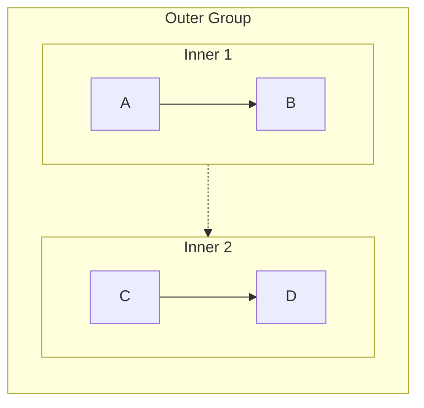
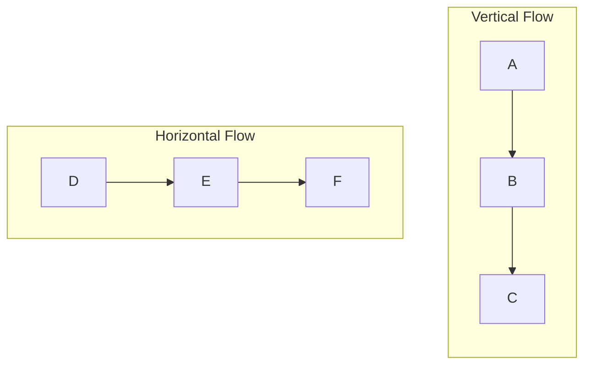
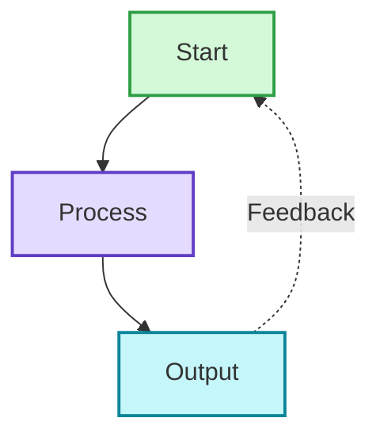
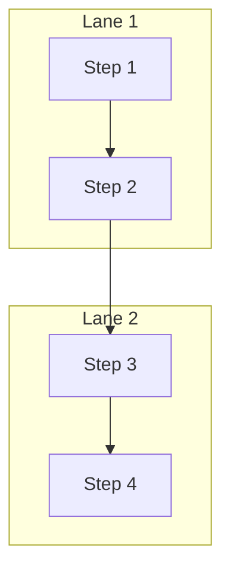
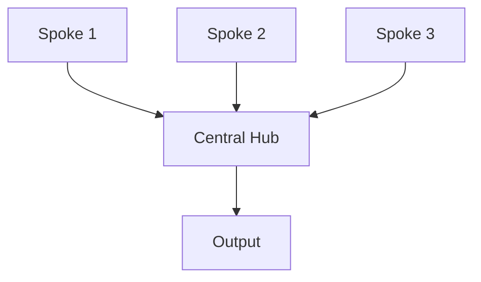

# Mermaid Syntax Rules Reference

This reference provides comprehensive syntax rules and error prevention strategies for Mermaid diagrams, specifically targeting **Mermaid 10.9.5**. Load this when encountering syntax errors or needing detailed syntax information.

## Table of Contents

1. [Mermaid 10.x Breaking Changes](#mermaid-10x-breaking-changes)
2. [Critical Error Prevention](#critical-error-prevention)
3. [Node Syntax](#node-syntax)
4. [Subgraph Syntax](#subgraph-syntax)
5. [Arrow and Connection Types](#arrow-and-connection-types)
6. [Styling and Colors](#styling-and-colors)
7. [Layout and Direction](#layout-and-direction)
8. [Advanced Patterns](#advanced-patterns)
9. [Troubleshooting](#troubleshooting)

## Mermaid 10.x Breaking Changes

### `flowchart` vs `graph` Keyword

Mermaid 10.x officially uses `flowchart` as the primary keyword. While `graph` may still parse, always use `flowchart` to avoid edge-case failures.

```
✅ flowchart TD   ← correct for 10.x
✅ flowchart LR
✅ flowchart TB
✅ flowchart RL
✅ flowchart BT

❌ graph TD      ← deprecated, may cause subtle errors
❌ flowchart TB
```

### classDef / class — No Semicolons

In 10.9.5, semicolons at the end of `classDef` or `class` statements cause parse errors.

```
❌ classDef myStyle fill:#f9f,stroke:#333;
   class A,B myStyle;

✅ classDef myStyle fill:#f9f,stroke:#333
   class A myStyle
   class B myStyle
```

Apply class to one node per `class` statement to avoid ambiguity.

### sequenceDiagram — Strict Indentation

All statements inside `sequenceDiagram` must be consistently indented (4 spaces recommended). Mixed indentation causes parse failures in 10.9.5.

```
❌ sequenceDiagram
   A->>B: call
     B-->>A: response     ← wrong: extra indent

✅ sequenceDiagram
    participant A
    participant B
    A->>B: call
    B-->>A: response
```

### Full-Width and Chinese Punctuation

Mermaid 10.x is stricter about Unicode. Full-width characters that look like ASCII but are not will silently break parsing.

**Never use these in syntax positions (arrows, labels, brackets):**

| Forbidden | Unicode | Correct |
|-----------|---------|---------|
| ：        | U+FF1A  | :       |
| （        | U+FF08  | (       |
| ）        | U+FF09  | )       |
| 　        | U+3000  | space   |
| ，        | U+FF0C  | ,       |
| ；        | U+FF1B  | ;       |
| ？        | U+FF1F  | ?       |

**Examples:**
```
❌ A --> B：说明           ← Chinese colon breaks label
✅ A -->|说明| B           ← use arrow label syntax

❌ A（节点）               ← Chinese parentheses in node ID
✅ A["节点"]               ← ASCII brackets with quotes

❌ A --> B　C --> D        ← full-width space between statements
✅ A --> B                 ← each statement on its own line
   C --> D
```

**Note:** Chinese text in node *labels* (inside `["中文内容"]`) is safe. The restriction applies to punctuation in *syntax* positions.

### Invisible Characters and Tab Mixing

Content copied from browsers, Word, or PDF sources often embeds:
- Non-breaking spaces (U+00A0) — looks like a space but is not
- Zero-width spaces (U+200B) — completely invisible
- Full-width spaces (U+3000)
- BOM characters (U+FEFF)
- Mixed tab + space indentation

These cause mysterious parse errors. Always re-type code rather than copy-pasting from formatted sources.

## Critical Error Prevention

### List Syntax Conflict (Most Common Error)

**Problem:** Mermaid parser interprets `number. space` as Markdown ordered list syntax.

**Error Message:** `Parse error: Unsupported markdown: list`

**Solutions:**

```mermaid
❌ [1. Perception]
❌ [2. Planning]
❌ [3. Reasoning]

✅ [1.Perception]           # Remove space
✅ [① Perception]           # Use circled numbers
✅ [(1) Perception]         # Use parentheses  
✅ [Step 1: Perception]     # Use prefix
✅ [Step 1 - Perception]    # Use dash
✅ [Perception]             # Remove numbering
```

**Circled number reference:**
```
① ② ③ ④ ⑤ ⑥ ⑦ ⑧ ⑨ ⑩ ⑪ ⑫ ⑬ ⑭ ⑮ ⑯ ⑰ ⑱ ⑲ ⑳
```

### Subgraph Naming Rules

**Rule:** Subgraphs with spaces must use ID + display name format.

```mermaid
❌ subgraph Core Process
     A --> B
   end

✅ subgraph core["Core Process"]
     A --> B
   end

✅ subgraph core_process
     A --> B
   end
```

**Referencing subgraphs:**
```mermaid
❌ Title --> Core Process      # Cannot reference display name
✅ Title --> core              # Must reference ID
```

### Node Reference Rules

**Rule:** Always reference nodes by ID, never by display text.

```mermaid
# Define nodes
A[Display Text A]
B["Display Text B"]

# Reference nodes
A --> B                        ✅ Use node IDs
Display Text A --> Display Text B  ❌ Cannot use display text
```

## Node Syntax

### Basic Node Types

```mermaid
# Rectangle (default)
A[Rectangle Text]

# Rectangle with rounded corners
B(Rounded Text)

# Stadium shape
C([Stadium Text])

# Circle
D((Circle<br/>Text))

# Asymmetric shape
E>Right Arrow]

# Rhombus (decision)
F{Decision?}

# Hexagon
G{{Hexagon}}

# Parallelogram
H[/Parallelogram/]

# Database
I[(Database)]

# Trapezoid
J[/Trapezoid\]
```

### Node Text Rules

**Line breaks:**
- `<br/>` only works in circle nodes: `((Text<br/>Break))`
- For other nodes, use separate annotation nodes or keep text concise

**Special characters:**
- Spaces: Use quotes if needed: `["Text with spaces"]`
- Quotes: Replace with 『』or avoid
- Parentheses: Replace with 「」or avoid
- Colons: Generally safe but avoid if causing issues
- Hyphens/dashes: Safe to use

**Length guidelines:**
- Keep node text under 50 characters
- Use multiple lines (circle nodes) or separate annotation nodes for longer content
- Consider splitting into multiple nodes if text is too long

## Subgraph Syntax

### Basic Structure

```mermaid
flowchart TB
    # Correct format with ID and display name
    subgraph id["Display Name"]
        direction TB
        A --> B
    end
    
    # Simple ID only (no spaces)
    subgraph simple
        C --> D
    end
    
    # Can set direction inside subgraph
    subgraph horiz["Horizontal"]
        direction LR
        E --> F
    end
```

### Nested Subgraphs



**Limitation:** Keep nesting to 2 levels maximum for readability.

### Connecting Subgraphs

```mermaid
flowchart TB
    subgraph g1["Group 1"]
        A[Node A]
    end
    
    subgraph g2["Group 2"]
        B[Node B]
    end
    
    # Connect individual nodes (recommended)
    A --> B
    
    # Connect subgraphs (creates invisible link for layout)
    g1 -.-> g2
```

## Arrow and Connection Types

### Basic Arrows

```mermaid
A --> B          # Solid arrow
A -.-> B         # Dashed arrow
A ==> B          # Thick arrow
A ~~~> B         # Invisible link (layout only, not rendered)
```

### Arrow Labels

```mermaid
A -->|Label Text| B
A -.->|Optional| B
A ==>|Important| B
```

### Multi-target Connections

```mermaid
# One to many
A --> B & C & D

# Many to one
A & B & C --> D

# Chaining
A --> B --> C --> D
```

### Bidirectional

```mermaid
A <--> B         # Bidirectional solid
A <-.-> B        # Bidirectional dashed
```

## Styling and Colors

### Inline Styling

```mermaid
style NodeID fill:#color,stroke:#color,stroke-width:2px
```

### Color Format

- Hex colors: `#ff0000` or `#f00`
- RGB: `rgb(255,0,0)`
- Color names: `red`, `blue`, etc. (limited support)

### Common Style Patterns

```mermaid
# Professional look
style A fill:#d3f9d8,stroke:#2f9e44,stroke-width:2px

# Emphasis
style B fill:#ffe3e3,stroke:#c92a2a,stroke-width:3px

# Muted/secondary
style C fill:#f8f9fa,stroke:#dee2e6,stroke-width:1px

# Title/header
style D fill:#1971c2,stroke:#1971c2,stroke-width:3px,color:#ffffff
```

### Styling Multiple Nodes

```mermaid
# Apply same style to multiple nodes
style A,B,C fill:#d3f9d8,stroke:#2f9e44,stroke-width:2px
```

## Layout and Direction

### Direction Codes

```mermaid
flowchart TB    # Top to Bottom (vertical)
flowchart BT    # Bottom to Top
flowchart LR    # Left to Right (horizontal)
flowchart RL    # Right to Left
flowchart TD    # Top Down (same as TB)
```

**Note:** `graph TD/TB` still works in most parsers but `flowchart` is the correct Mermaid 10.x syntax.

### Layout Control Tips

1. **Vertical layouts (TB/BT):** Best for sequential processes, hierarchies
2. **Horizontal layouts (LR/RL):** Best for timelines, wide displays
3. **Mixed directions:** Set different directions in subgraphs



## Advanced Patterns

### Feedback Loop Pattern



### Swimlane Pattern



### Hub and Spoke



### Decision Tree

```mermaid
flowchart TB
    Start[Start] --> Decision{Decision Point?}
    Decision -->|Option A| PathA[Path A]
    Decision -->|Option B| PathB[Path B]
    Decision -->|Option C| PathC[Path C]
    
    PathA --> End[End]
    PathB --> End
    PathC --> End
```

### Comparison Layout

```mermaid
flowchart TB
    Title[Comparison]
    
    subgraph left["System A"]
        A1[Feature 1]
        A2[Feature 2]
        A3[Feature 3]
    end
    
    subgraph right["System B"]
        B1[Feature 1]
        B2[Feature 2]
        B3[Feature 3]
    end
    
    Title --> left
    Title --> right
    
    subgraph compare["Key Differences"]
        Diff[Difference Summary]
    end
    
    left --> compare
    right --> compare
```

## Troubleshooting

### Common Errors and Solutions

#### Error: "Syntax error in text" (Mermaid 10.9.5 generic)

This is the most generic error in 10.9.5. Work through this checklist:

1. Are you using `graph TD` instead of `flowchart TD`? → Switch to `flowchart`
2. Is there a full-width character hiding in the code? → Check for `：（）　` etc.
3. Did you copy-paste from a webpage or document? → Re-type the code manually
4. Are there mixed tabs and spaces? → Use only spaces (4 per level)
5. Is a `classDef` or `class` line ending with `;`? → Remove semicolons
6. Does a `sequenceDiagram` have inconsistent indentation? → Normalize to 4 spaces

#### Error: "Parse error on line X: Expecting 'SEMI', 'NEWLINE', 'EOF'"

**Causes:**
1. Subgraph name with spaces not using ID format
2. Node reference using display text instead of ID
3. Invalid special characters in node text
4. Full-width colon `：` in a label position

**Solutions:**
- Use `subgraph id["Display Name"]` format
- Reference nodes by ID only
- Quote node text with special characters
- Replace `：` with `:` or use `-->|label| B` arrow label format

#### Error: "Unsupported markdown: list"

**Cause:** Using `number. space` pattern in node text

**Solution:** Remove space or use alternatives (①, (1), Step 1:)

#### Error: "Parse error: unexpected character"

**Causes:**
1. Unescaped special characters
2. Full-width punctuation (：，（）) in syntax positions
3. Improper quotes
4. Invisible Unicode characters (U+00A0, U+200B, U+FEFF)

**Solutions:**
- Replace full-width punctuation with ASCII equivalents
- Replace problematic ASCII characters (double-quotes → `『』`)
- Use `["text with parens (ok)"]` — wrap in quotes to allow parens in labels
- Re-type rather than copy-paste from formatted sources

#### Error: classDef/class not applying styles

**Cause:** Semicolons at end of `classDef` or `class` statements in 10.9.5

**Solution:**
```
❌ classDef warning fill:#ff0,stroke:#333;
   class A,B warning;

✅ classDef warning fill:#ff0,stroke:#333
   class A warning
   class B warning
```

#### sequenceDiagram renders incorrectly or fails

**Causes:**
1. Inconsistent indentation (mixing 2-space, 4-space, tabs)
2. Missing `participant` declarations for actors
3. Message text containing `:`-heavy content

**Solutions:**
- Use exactly 4 spaces for all statements inside `sequenceDiagram`
- Declare all participants explicitly at the top
- Wrap message text in quotes if it contains colons: `A->>B: "key: value"`

#### Diagram doesn't render correctly

**Causes:**
1. Missing style declarations
2. Incorrect direction specification
3. Invalid connections
4. Using `graph` keyword instead of `flowchart`

**Solutions:**
- Switch `graph TD` → `flowchart TD`
- Verify all style declarations use valid syntax (no trailing semicolons)
- Check direction is set in flowchart declaration or subgraph
- Ensure all node IDs are defined before referencing

### Validation Checklist

Before finalizing any diagram:

- [ ] Using `flowchart TD/LR/TB` (NOT `graph TD`)
- [ ] No `number. space` patterns in node text
- [ ] All subgraphs use proper ID syntax if they contain spaces
- [ ] All node references use IDs not display text
- [ ] All arrows use valid syntax (-->, -.->)
- [ ] All style declarations are syntactically correct (no trailing `;`)
- [ ] Direction is explicitly set
- [ ] No full-width punctuation (：（）　，) in syntax positions
- [ ] No unescaped special characters in node text
- [ ] No invisible characters or tab/space mixing
- [ ] sequenceDiagram uses consistent 4-space indentation
- [ ] All connections reference defined nodes

### Platform-Specific Notes

**Obsidian:**
- Older Mermaid version, more strict parsing
- Limited support for `<br/>` (only in circle nodes)
- Test diagrams before finalizing

**GitHub:**
- Good Mermaid support
- Renders most modern syntax
- May differ slightly from Obsidian rendering

**Mermaid Live Editor:**
- Most up-to-date parser
- Best for testing new syntax
- May support features not available in Obsidian/GitHub

## Quick Reference

### Safe Numbering Methods
✅ `1.Text` `①Text` `(1)Text` `Step 1:Text`
❌ `1. Text`

### Safe Subgraph Syntax
✅ `subgraph id["Name"]` `subgraph simple_name`
❌ `subgraph Name With Spaces`

### Safe Node References
✅ `NodeID --> AnotherID`
❌ `"Display Text" --> "Other Text"`

### Safe Special Characters
✅ `『』` for quotes, `「」` for parentheses
❌ `"` unescaped quotes, `()` in problematic contexts