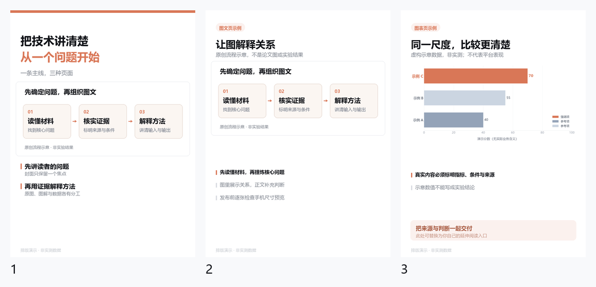

# 小红书文案与图片：快速开始

生成标题、正文、标签和 1080×1440 竖版图，附手机尺寸预览。
文案由 AI 根据材料撰写；脚本负责长度检查和卡片排版，不会自动发帖。

## 安装与运行

将整个 `xiaohongshu/` 文件夹复制到 AI 工具的技能目录。
例如 Claude Code 的 `~/.claude/skills/`。下面从本技能目录执行：

```bash
python -m pip install -r requirements.txt
python scripts/count.py examples/body.txt examples/title.txt
python scripts/make_cards.py examples/demo.json
```

长度检查只需 Python 标准库；图片需要 Pillow，条形图另用 Matplotlib。
推荐 Python 3.10+。演示图与预览写到 `output/demo/`，不会混入源文件。
`examples/demo.json` 同时覆盖封面、图文和条形图三种页面，配套图解为原创示意。
所有演示分数均为虚构值，不是平台数据或真实实验结果。



## 字体

脚本会尝试 Windows 微软雅黑、macOS 苹方和 Linux Noto CJK 的常见位置。
找不到字体时，请提供本机已有的中文字体文件：

```json
{
  "font_regular": "/path/to/chinese-regular.ttf",
  "font_bold": "/path/to/chinese-bold.ttf"
}
```

这两个字段放在配置顶层。也可以设置 `XHS_FONT_REGULAR` 和 `XHS_FONT_BOLD`
环境变量；配置字段优先。可以把同一个支持中文的字体用于两个字段。
仓库不分发字体文件，使用者自行安装或提供字体。

## 换成自己的内容

复制 `examples/demo.json`，修改 `pages`、`src_root`、`out_dir`、`watermark` 和可选 `cta`。
所有相对路径均以配置文件所在目录为准，`image` 和 `hero` 相对于 `src_root`。
将图片放进自己的素材目录后引用；不要把演示数值当成真实结果。
相同输出路径再次生成会覆盖同名卡片，新帖子请使用新的 `out_dir`。

| 页面 | 用途 | 必填内容 |
|---|---|---|
| `cover` | 封面 | `line1`、`line2`；可选 `hero` 或 `metric` |
| `figure` | 原图或原创图解 | `title`、`image`；可选 `bullets`、`stat` |
| `bar` | 数据对比 | `title`、`series`；每项为 `[名称, 数值, 类别]` |

条形图类别为 `ours`、`other` 或 `alt`。`ours` 只是强调色，并不表示真实优劣。
完整字段和写作流程见 [SKILL.md](SKILL.md)。

## 字数与交付

`count.py` 默认正文上限 1000、标题上限 20，按 UTF-16 单元计算。
最终正文要包含标签与链接再检查；平台发布界面的当前提示优先。
命令参数顺序为正文文件、标题文件，超限返回退出码 1。

预览位于 `_previews/`：360px 宽各页、240px 宽封面和总览。
逐张核对裁剪、图例、遮挡及可读性；交付按序编号的原图。
默认只在末页放延伸入口。技术内容区分已验证结果、个人判断和研究设想，
不要承诺流量、转化或不存在的材料。
